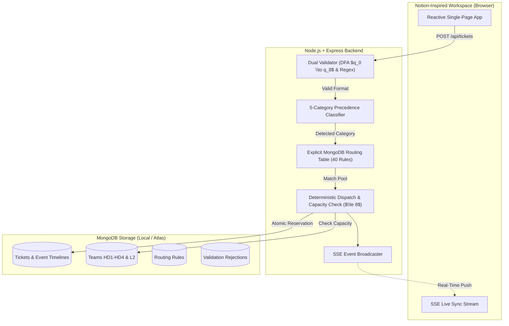

<div align="center">

# IT Helpdesk Ticket Router

### A Premium Notion-Inspired ITSM Operations Workspace

[](https://nodejs.org/)
[](https://expressjs.com/)
[](https://www.mongodb.com/)
[](#real-time-sse-stream)
[](#interface-design-and-features)

<p align="center">
  <b>A production-grade IT Service Management (ITSM) web application built with a distraction-free, Notion-inspired aesthetic.</b><br>
  Features silent deterministic automata verification, a 5-category precedence classifier, explicit MongoDB routing rules, 8-ticket team capacity controls, and real-time multi-client live sync.
</p>

[Quick Start](#quick-start) • [Core Features](#interface-design-and-features) • [Architecture](#system-architecture) • [Algorithms](#core-algorithms) • [API Spec](#rest-api-reference)

---

</div>

## Key Capabilities

<table>
  <tr>
    <td width="50%">
      <h3>Notion-Style Database & Kanban</h3>
      <p>Seamlessly toggle between a spreadsheet-style <b>Database Table</b> (with search, property filters, and pagination) and a <b>Kanban Board View</b> organized by operational status.</p>
    </td>
    <td width="50%">
      <h3>Real-Time SSE Multi-Client Sync</h3>
      <p>Instant Server-Sent Events (SSE) broadcast updates across all connected browsers in real time without manual page refreshes or polling lag.</p>
    </td>
  </tr>
  <tr>
    <td width="50%">
      <h3>Silent Automata Validation</h3>
      <p>Validates structured device identifiers (<code>DEPT-ISSUE-PRIORITY</code>, e.g. <code>CS-101-H</code>) in real time using a <b>Deterministic Finite Automaton (DFA)</b> and equivalent <b>Regular Expression</b> without exposing academic clutter.</p>
    </td>
    <td width="50%">
      <h3>Strict 8-Ticket Capacity Guards</h3>
      <p>Strictly caps open workloads across 4 Tier-1 Helpdesk teams (<b>HD1–HD4</b>) at <b>8 open tickets</b>. Automatically routes overflow to Level-2 escalation or waiting queues.</p>
    </td>
  </tr>
  <tr>
    <td width="50%">
      <h3>Slide-Over Ticket Drawer</h3>
      <p>Clicking any ticket smoothly reveals a right-hand inspection drawer featuring complete chronological audit timelines, quick status progression buttons, and attached files.</p>
    </td>
    <td width="50%">
      <h3>Diagnostic Attachments & CSV Export</h3>
      <p>Upload screenshots and diagnostic log files (up to 2MB) directly with incident reports, and export clean, formatted RFC-4180 CSV reports in one click.</p>
    </td>
  </tr>
</table>

---

## System Architecture



---

## Core Algorithms

The engine ([`helpdesk-router/engine.js`](file:///c:/Users/haris/Desktop/Hackathon/helpdesk-router/engine.js)) provides pure, deterministic algorithmic verification:

### 1. Deterministic Finite Automaton (DFA) & Regex

* **Identifier Format:** Exactly 8 characters `DEPT-ISSUE-PRIORITY` (e.g., `CS-101-H`).
* **Equivalent Regular Expression:**
  ```regex
  ^[A-Z]{2}-[0-9]{3}-[HML]$
  ```
* **State Transition Table:**

| State | Input Character | Next State | Description |
|:---:|:---:|:---:|---|
| **$q_0$** | `A–Z` | $q_1$ | First department letter |
| **$q_1$** | `A–Z` | $q_2$ | Second department letter |
| **$q_2$** | `-` | $q_3$ | First delimiter hyphen |
| **$q_3$** | `0–9` | $q_4$ | First issue digit |
| **$q_4$** | `0–9` | $q_5$ | Second issue digit |
| **$q_5$** | `0–9` | $q_6$ | Third issue digit |
| **$q_6$** | `-` | $q_7$ | Second delimiter hyphen |
| **$q_7$** | `H`, `M`, `L` | **$q_8$ (Accepting)** | Priority level |
| *Any* | *Any other char* | **$X$ (Dead State)** | Immediate rejection with exact position & reason |

> **Agreement Guarantee:** Both the DFA and Regex evaluate every submission and produce 100% identical validation outcomes across all valid and boundary inputs.

---

### 2. Five-Category Issue Classifier with Precedence

Reports are classified into exactly five categories based on issue code ranges (100–599) and contextual description keywords:

* `100–199` $\to$ **Hardware** (*laptop, computer, screen, monitor, keyboard, printer*)
* `200–299` $\to$ **Software** (*install, license, application, update, crash, office*)
* `300–399` $\to$ **Network** (*wi-fi, network, internet, lan, vpn, router, switch*)
* `400–499` $\to$ **Access** (*password, login, account, locked, permission*)
* `500–599` $\to$ **Other** (*general requests, consumables*)

#### Conflict Resolution Precedence Order
When a report's issue code and description keywords match different categories, the system applies strict, deterministic conflict resolution:
$$\mathbf{Network} \succ \mathbf{Access} \succ \mathbf{Hardware} \succ \mathbf{Software} \succ \mathbf{Other}$$

---

### 3. Explicit Routing, Capacity Limits & Overrides

* **4 Helpdesk Teams:** `HD1`, `HD2`, `HD3`, `HD4` strictly capped at **8 open tickets** (`Assigned` or `In Progress`).
* **Level-2 Escalation Team:** `L2` capped at **10 open tickets**.
* **Emergency Priority Override:** High-priority (`H`) Network tickets immediately bypass Tier-1 and route directly to Level-2 (`L2`).
* **Round-Robin Scheduling:** Rotates deterministically across eligible teams within the matched department/category pool.
* **Central Fallback Queue:** Reports with unmapped codes or unknown departments enter the Fallback Queue for one-click operator reassignment.
* **Waiting Queue:** If all eligible teams reach capacity (8 tickets), reports wait in a deterministic priority-sorted queue ($H \succ M \succ L \succ \text{Submission Time}$).

---

## Interface Design and Features

Designed with a warm-neutral aesthetic inspired by Notion and Linear:

```text
+------------------------------------------------------------------------------------------+
| [=] Sidebar Toggle  /  Workspace Navigation Breadcrumb             [Search (/)] [Live *] |
+------------------+-----------------------------------------------------------------------+
| SIDEBAR          | MAIN WORKSPACE CANVAS                                                 |
|                  |                                                                       |
| [H] Helpdesk     | Operations Home / My Tickets / Submit / Handler / Routing / Analytics |
| IT Operations    | --------------------------------------------------------------------- |
|                  | Stat Cards: [Active Tickets] [Resolution Rate] [Fallback] [Capacity]  |
| Overview         | --------------------------------------------------------------------- |
| - Home           | Notion Database Table / Kanban Board View                             |
| - My Tickets     |                                                                       |
| - Submit Report  | [TKT-0001] [CS-101-H] [Hardware] [High] [Assigned] [HD1] [2h ago]    |
|                  | [TKT-0002] [EE-205-M] [Software] [Med]  [Progress] [HD2] [1h ago]    |
| Management       |                                                                       |
| - Handler Desk   |                                                                       |
| - Routing Rules  |                                                                       |
| - Analytics      |                                                                       |
| Preferences      |                                                                       |
| - Settings       |                                                                       |
+------------------+-----------------------------------------------------------------------+
```

### 1. Operations Home
* Key metrics strip: *Active Tickets*, *Resolution Rate*, *Fallback Queue*, *Waiting Queue*.
* Recent activity feed and real-time team workload capacity meters.

### 2. My Tickets Database
* **Table View:** Dense data table with search (`/`), property filters (Category, Priority, Status), and pagination.
* **Kanban Board View:** 4-column visual board (*Pending*, *Assigned*, *In Progress*, *Resolved*).
* **Slide-over Drawer:** Complete event history timeline and quick status progression buttons.
* **CSV Export:** Download filtered tickets as a clean `.csv` file.

### 3. Submit Report Form
* Centered minimalist form with silent, real-time DFA validation.
* File dropzone supporting screenshots and diagnostic log files ($\le 2$ MB).

### 4. Handler Workspace
* Team selector tabs (`HD1`, `HD2`, `HD3`, `HD4`, `Level-2`).
* Capacity utilization bar with 8-ticket limit warnings and team availability toggle.

### 5. Routing Database
* 40 explicit routing rules stored in MongoDB.
* Central Fallback Queue with instant operator reassignment.
* Escalations and priority overrides audit log.

### 6. Service Analytics
* Category volume distribution horizontal bars with exact counts and percentages.
* Zonal load breakdown across *North Block*, *South Block*, *Admin Block*, and *Library Wing*.
* Resolution ratio SVG donut chart.

### 7. Settings
* Appearance theme switcher: **Light (Warm Neutral)** vs. **Dark (Obsidian)**.
* One-click demo seeder (14 realistic tickets) and database reset tools.

---

## Quick Start

### Prerequisites
* [Node.js](https://nodejs.org/) v18+
* [MongoDB](https://www.mongodb.com/) running locally on port `27017`

### Installation & Run

```bash
# 1. Clone repository
git clone https://github.com/AdithyaHKashyap/005_24_P2.git
cd 005_24_P2/helpdesk-router

# 2. Install dependencies
npm install

# 3. Start application
npm start
```

Open your browser at: **`http://localhost:4000`**

Click **"Load Demo"** in the topbar to instantly populate 14 realistic support tickets and explore all views.

---

## REST API Reference

| Method | Endpoint | Description |
|:---:|---|---|
| `GET` | `/api/state` | Returns all tickets, team loads, rejects, and routing rules |
| `GET` | `/api/stream` | Server-Sent Events (SSE) real-time streaming connection |
| `GET` | `/api/tickets/export/csv` | Downloads all tickets as an RFC-4180 CSV export |
| `POST` | `/api/tickets` | Validates, classifies, routes, and creates a report |
| `PATCH` | `/api/tickets/:id` | Updates ticket status (`Assigned`, `In Progress`, `Resolved`) or reopens |
| `POST` | `/api/tickets/:id/reassign` | Manually reassigns ticket to target team with audit event |
| `PATCH` | `/api/teams/:id` | Toggles availability (`avail`) or adjusts capacity (`cap`) |
| `GET` | `/api/routing-rules` | Returns all 40 active routing rules |
| `PATCH` | `/api/routing-rules/:id`| Updates preferred or backup teams for a routing rule |
| `POST` | `/api/demo` | Populates 14 realistic demo tickets across all categories |
| `POST` | `/api/reset` | Resets all ticket collections and restores default capacities |

---

## Keyboard Shortcuts

| Shortcut | Action |
|:---:|---|
| `/` | Focus ticket search bar |
| `Escape` | Close Slide-over Ticket Drawer |
| `Ctrl + \` | Collapse / Expand sidebar navigation |

---

## Project Structure

```text
005_24_P2/
├── README.md                      # Primary project overview & documentation
├── helpdesk-router/
│   ├── server.js                  # Express backend, Mongoose models, SSE stream, REST API
│   ├── engine.js                  # DFA validator, equivalent Regex, 5-category classifier
│   ├── package.json               # Backend dependencies (express, mongoose)
│   ├── README.md                  # Application-specific documentation
│   └── public/
│       └── index.html             # Notion-inspired workspace frontend (all 7 views)
├── docs/
│   ├── NOTION_INSPIRED_DESIGN.md  # Complete UI/UX design tokens & specification
│   ├── UI_AND_SYSTEM_AUDIT.md     # Multi-agent system audit & database inspection report
│   ├── REQUIREMENTS_TRACEABILITY.md # Traceability matrix (FR-01 through FR-20)
│   ├── DECISIONS.md               # Architecture decisions & conflict resolutions register
│   └── BUILD_STATUS.md            # Task progress & stage verification log
└── IT_Helpdesk_Ticket_Router_v2/  # Baseline academic requirements pack
```

---

<div align="center">
  <b>IT Helpdesk Ticket Router</b> • Built with precision, performance, and simplicity.
</div>
