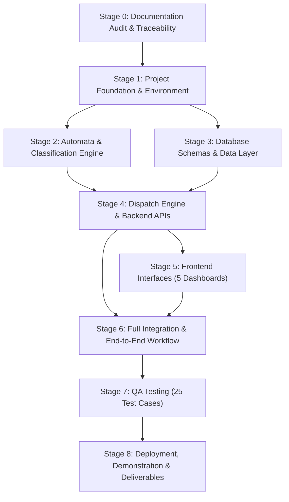

# Agent Task Allocation and Workflow

**Project:** IT Helpdesk Ticket Router  
**Architecture Lead:** Agent 0 (Orchestrator)

---

## 1. Agent Roles & Responsibilities

### Agent 0: Orchestrator / Lead Architect
- Overall project coordination, interface contracts, stage gating, verification.
- Manages `docs/BUILD_STATUS.md`, `docs/DECISIONS.md`, and requirements compliance.
- Resolves cross-agent blockers and reviews deliverables before marking stages complete.

### Agent 1: Backend Developer
- Express server architecture, REST API implementation (`/api/v1/*`).
- Authentication and authorization (JWT, bcrypt password hashing, role-based access control).
- Report management endpoints, Handler management endpoints, Routing management endpoints.
- Error handling middleware, audit logging, input sanitization.

### Agent 2: Database Engineer
- MongoDB Mongoose schema design: `User`, `Handler`, `Report`, `RoutingRule`, `AssignmentEvent`, `StatusEvent`, `AuditLog`.
- Unique constraints, indexes, atomic transactional reservations for capacity.
- Database seed script with initial users (admin, handler, reporter), 4 helpdesk teams (`HD1`..`HD4`), `L2` team, and comprehensive routing rules.
- Data integrity checks preventing duplicate active assignments and capacity overflow (> 8).

### Agent 3: Frontend Developer
- Production-grade, responsive React UI (Vite + React + Tailwind CSS / modular styling).
- 5 Core Interfaces:
  1. Report Submission Interface (`/reports/new`) with live validation and preview.
  2. Reporter Dashboard (`/dashboard`) with ticket search, status filters, and timeline view.
  3. Handler Dashboard (`/handler`) with workload metrics, availability toggle, and status updater.
  4. Routing Management Dashboard (`/routing`) with routing rule editor, fallback queue view, and team load meters.
  5. Analytics Dashboard (`/analytics`) with category distribution, zone breakdown, and resolution metrics.
- Navigation shell, role-based route guard, error boundaries, loading skeletons.

### Agent 4: Automata and Dispatch Engineer
- DFA & Regex Validation Engine:
  - JavaScript implementation (`server/src/services/dfaValidator.js`).
  - Python implementation (`scripts/dfa_regex_demo.py`) for academic deliverable.
  - Test harness verifying 100% agreement between DFA and Regex on all edge cases.
- 5-Category Classifier:
  - Issue code ranges (100–599) and keyword matching.
  - Conflict precedence order: `Network > Access > Hardware > Software > Other`.
- Routing & Dispatch Engine:
  - Route table lookup by `(departmentCode, category)`.
  - Priority override logic (High/Critical Network -> Level-2).
  - Round-robin rotation across eligible pool with persistent state pointers.
  - Backup team fallback sequence and capacity checks (max 8 open tickets).
  - Central Fallback Queue and deterministic queue sorting.

### Agent 5: QA and Test Engineer
- Automated unit tests for DFA, Regex, Classifier, and Dispatcher.
- API integration tests (`supertest` / API test suite).
- 25 documented test cases covering:
  - T01–T08: DFA/Regex validation & agreement.
  - T09–T14: 5-category classification & precedence.
  - T15–T16: Routing table lookup & fallback queue.
  - T17–T20: Dispatch, round-robin, backup, capacity overflow (>8).
  - T21: Priority override (emergency/critical).
  - T22–T23: Duplicate prevention & concurrency race conditions.
  - T24–T25: Status transitions & analytics updates.
- Produces `docs/TEST_REPORT.md` and `docs/KNOWN_ISSUES.md`.

---

## 2. Stage-by-Stage Work Breakdown

