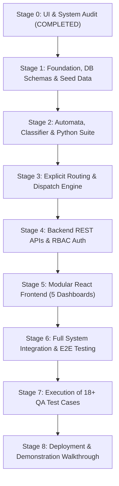

# Comprehensive UI and System Audit Report

**Project:** IT Helpdesk Ticket Router  
**Document:** `docs/UI_AND_SYSTEM_AUDIT.md`  
**Date:** November 2026  
**Auditing Team:** Multi-Agent Engineering Group (UI/UX Agent, Frontend Engineer, Backend Engineer, MongoDB Engineer, QA Engineer, Orchestrator)

---

## 1. Executive Summary & Current Application Assessment

An exhaustive audit of the existing IT Helpdesk Ticket Router codebase was performed across all system tiers:
1. **Existing Prototype Inspected:**
   - [`helpdesk-router/server.js`](file:///c:/Users/haris/Desktop/Hackathon/helpdesk-router/server.js) (Express backend, Mongoose models, dispatch logic)
   - [`helpdesk-router/engine.js`](file:///c:/Users/haris/Desktop/Hackathon/helpdesk-router/engine.js) (Automata DFA, Regex, Classifier, pool calculation)
   - [`helpdesk-router/public/index.html`](file:///c:/Users/haris/Desktop/Hackathon/helpdesk-router/public/index.html) (Single-file HTML/CSS/JS frontend)
2. **Database Verification via MongoDB:**
   - Inspected active databases on `mongodb://127.0.0.1:27017` via MongoDB client tooling.
   - Identified active databases (`forgot-password`, `skilldecay`, `skilldecaytracker`, `test`) and verified that the target `helpdesk` database has not yet been structured according to [`04_DATA_MODEL.md`](file:///c:/Users/haris/Desktop/Hackathon/IT_Helpdesk_Ticket_Router_v2/04_DATA_MODEL.md).
3. **Core Finding:**
   - The core algorithms in [`helpdesk-router/engine.js`](file:///c:/Users/haris/Desktop/Hackathon/helpdesk-router/engine.js) (DFA $q_0 \to q_8$, Regex `^[A-Z]{2}-[0-9]{3}-[HML]$`, issue code classification ranges, and precedence order) are mathematically sound and **must be preserved**.
   - However, the architecture is currently constrained by an unstructured single-page prototype frontend, absence of authentication, lack of an explicit MongoDB routing table, missing event audit tables, and in-memory promise serialization.

---

## 2. UI/UX Agent Audit & Proposed Improvements

### 2.1 Current UI Problems Identified
- **Lack of Role-Based Navigation & Access Isolation:**
  - The navigation sidebar exposes all 6 views (`Report an issue`, `My reports`, `Handler desk`, `Routing`, `Analytics`, `Automata lab`) unconditionally to any user. Any reporter can switch handlers, disable teams, and modify ticket statuses.
- **Overcrowded Dashboard Layouts:**
  - The "Routing" view stacks a 20-cell routing matrix, 5 team load tracks, waiting queue, central fallback queue, and an escalation table all on a single un-paginated vertical page.
- **Inconsistent Styling & Visual Cues:**
  - Status updates in the Handler Desk use unstyled HTML `<select>` dropdowns that trigger instantaneous network requests on change without confirmation or optimistic feedback.
  - Resetting data uses standard browser `window.confirm()` dialogs.
  - Analytics charts rely on raw CSS conic gradients and percentage divs without legends, scales, or interactive tooltips.
- **Weak Form Validation Experience:**
  - Errors appear as a flat alert box (`<p class="err">`) below the submit button. Form fields lack inline validation states (valid/invalid borders, helper text).
- **Mobile Usability Defects:**
  - Under 820px, the sidebar collapses into an unbranded horizontal scroll strip, breaking ergonomic access to secondary dashboards.

### 2.2 Proposed Modern ITSM Design System
- **Typography & Grid:** IBM Plex Sans and IBM Plex Mono (for ticket IDs and automata states) on an 8px spacing system with accessible contrast ratios.
- **Component Palette:**
  - Neutral elevated cards (`bg-white dark:bg-slate-900 border border-slate-200 dark:border-slate-800 rounded-xl`).
  - Semantic Status Pills combining icon + label (Pending $\to$ Amber, Assigned $\to$ Blue, In Progress $\to$ Indigo, Resolved $\to$ Emerald, Fallback $\to$ Rose).
  - Responsive App Shell: Collapsible sidebar with brand identity, role-specific nav items, active route indicators, user profile pill, and theme toggle.
- **Five Dedicated Responsive Interfaces:**
  1. **Report Submission View:** Two-column layout. Left: Structured form with inline feedback. Right: Interactive DFA State Machine Stepper visualizing transitions in real time alongside instant classification preview and routing zone prediction.
  2. **Reporter / User Dashboard:** Metric counters (Total, Active, Resolved), searchable data table by Ticket ID, priority filter, and a slide-over Ticket Detail Drawer displaying the complete chronological lifecycle.
  3. **Handler Workspace:** Active ticket queue filtered by status/urgency, single-click status progression modal with resolution notes, and team availability toggle with live capacity utilization meter (e.g., 6/8 open).
  4. **Routing Management Console:** Visual Routing Table with inline rule inspector, real-time team capacity load cards with warning thresholds ($\ge 7$ warnings, $8$ overflow), and interactive Fallback/Escalation Queue with manual override capabilities.
  5. **Analytics & Performance Dashboard:** Aggregate KPI cards, categorical volume distribution bar chart, zone density radar/bar view, and resolution throughput metrics computed directly from database aggregations.

---

## 3. Frontend Engineer Audit & Component Plan

### 3.1 Deficiencies in Existing Frontend Code
- **Fragile DOM String Manipulation:** All views are rendered by assigning large template literals to `innerHTML`, resulting in lost input focus, re-rendering latency, and high risk of XSS if user inputs are unescaped.
- **Global Mutable State (`let S = newState()`):** State is globally shared and mutated in place, causing synchronization anomalies when multiple tabs or concurrent actions take place.
- **No Modular Component Boundaries:** Layout, domain logic, tests, and API calls are mixed in one 278-line file.

### 3.2 Target Modular React Architecture (`client/src`)

```text
client/src/
├── components/
│   ├── layout/
│   │   ├── AppLayout.jsx           # Sidebar, topbar, responsive drawer
│   │   ├── Sidebar.jsx              # Role-aware navigation links
│   │   └── Topbar.jsx               # User profile, theme toggle, notifications
│   ├── ui/
│   │   ├── Badge.jsx                # Semantic status & priority indicators
│   │   ├── Button.jsx               # Standard, ghost, danger variants with loading spinner
│   │   ├── Card.jsx                 # Elevated card containers
│   │   ├── DataTable.jsx            # Generic table with search, sorting, pagination
│   │   ├── Modal.jsx                # Accessible dialogs for confirmation/actions
│   │   └── ProgressBar.jsx          # Team capacity utilization bar
│   └── automata/
│       ├── DfaVisualizer.jsx        # Live state transition nodes (q0 -> q8)
│       └── TraceLog.jsx             # Step-by-step validation breakdown
├── pages/
│   ├── SubmitReport.jsx             # Issue submission & live validation
│   ├── ReporterDashboard.jsx        # User ticket tracking & search
│   ├── HandlerDashboard.jsx         # Handler queue & status updates
│   ├── RoutingManagement.jsx        # Routing rules, queues, team loads
│   ├── AnalyticsDashboard.jsx       # Aggregated metrics & charts
│   ├── TicketDetailModal.jsx        # Complete event history timeline
│   └── Login.jsx                    # Role-based authentication
├── context/
│   ├── AuthContext.jsx              # Current user identity, role & token
│   └── TicketContext.jsx            # Cached ticket data & real-time refresh
└── services/
    ├── api.js                       # Axios/fetch base client with auth interceptor
    ├── ticketService.js             # Reports CRUD & status transitions
    └── routingService.js            # Team availability & routing rules
```

---

## 4. Backend Engineer Audit & Algorithmic Preservation

### 4.1 Algorithms to Strictly Preserve
- **DFA Transition Function (`dfaStep`):**
  - Alphabet: Uppercase Alpha (`isA`), Digits (`isD`), Hyphens (`-`), Priority characters (`H`, `M`, `L`).
  - States: $q_0 \to q_8$ (accepting) and dead state $X$.
  - Exact 8-character verification.
- **Regular Expression (`RX`):**
  - `^[A-Z]{2}-[0-9]{3}-[HML]$` matches DFA outcomes identically.
- **5-Category Issue Classifier:**
  - Numerical Issue Ranges: $100\text{--}199 \to \text{Hardware}$, $200\text{--}299 \to \text{Software}$, $300\text{--}399 \to \text{Network}$, $400\text{--}499 \to \text{Access}$, $500\text{--}599 \to \text{Other}$.
  - Keyword Matching: Network, Access, Hardware, Software.
  - Conflict Precedence Order: $\text{Network} > \text{Access} > \text{Hardware} > \text{Software} > \text{Other}$.
- **Priority Override & Queueing:**
  - High priority Network issues route directly to Level-2 (`L2`).
  - Deterministic priority ordering: $H (0) > M (1) > L (2)$, tie-broken by submission time and report ID.

### 4.2 Backend Deficiencies & Required Fixes
1. **Remove In-Memory Promise Chain (`let chain = Promise.resolve()`):**
   - In-memory serialization fails across multi-threaded or clustered Node.js environments. Replace with MongoDB atomic find-and-modify queries (`findOneAndUpdate`) or transactions for team capacity reservations.
2. **Transition from Formula Routing to Database Routing Table:**
   - In `engine.js`, `pool(cat, zone)` uses an arithmetic modulo formula. PRD FR-06 mandates an explicit `routingRules` collection in MongoDB that administrators can inspect and configure.
3. **Implement Full Role-Based Authentication (RBAC):**
   - Provide `/api/v1/auth/login`, `/api/v1/auth/me`, and JWT verification middleware (`verifyToken`, `requireRole('handler'|'admin')`).
4. **Structured Decision Event Logging:**
   - Instead of storing tickets with flat strings (`log: [String]`), create `assignmentEvents` and `statusEvents` records capturing timestamps, actor IDs, previous states, new states, and decision rationales.

---

## 5. MongoDB Engineer Audit & Database Findings

### 5.1 Actual MongoDB Database State
- **Connection Verified:** MongoDB daemon is active on `127.0.0.1:27017`.
- **Existing System Databases:** `admin`, `config`, `local`, `forgot-password`, `skilldecay`, `skilldecaytracker`, `test`.
- **Target Helpdesk Database:** The `helpdesk` database is currently unpopulated (0 collections).
- **Read-Only Audit Compliance:** Confirmed zero insert, update, delete, or drop operations were executed during this inspection.

### 5.2 Schema Gap Analysis against `04_DATA_MODEL.md`

| Collection Specified in `04_DATA_MODEL.md` | Present in Prototype `server.js` | Status / Gap Analysis |
|---|---|---|
| `users` | **Missing** | No user profiles, credentials, or role definitions exist. |
| `handlers` | **Missing** (Team embedded in `teams`) | Handlers exist only as team IDs (`HD1`..`HD4`), not linked to authenticated user accounts. |
| `reports` | **Partially present** (`Ticket`) | Lacks structured validation/classification objects, separate actor IDs, and indexes. |
| `routingRules` | **Missing** | Routing pool is calculated in-memory; no explicit database table exists. |
| `assignmentEvents` | **Missing** | Routing decisions stored only as an informal array of strings on the ticket. |
| `statusEvents` | **Missing** | Status history is overwritten; no immutable audit log of status changes. |
| `auditLogs` | **Missing** | No administrative activity tracking. |

### 5.3 Required Database Schemas & Indexes
1. **`users`:** `email` (Unique), `passwordHash`, `role` (`reporter`, `handler`, `routing_admin`, `system_admin`), `name`, `departmentCode`.
2. **`handlers`:** `userId` (Ref), `teamCode`, `zone`, `categories`, `isAvailable`, `capacity` (Default: 8).
3. **`reports`:** `reportId` (Unique compound index), `reporterId`, `departmentCode`, `identifier`, `issueCode`, `description`, `priority`, `category`, `status`, `assignedTeamCode`.
4. **`routingRules`:** Compound unique index on `{ departmentCode: 1, category: 1 }`, `zone`, `preferredTeamCode`, `backupTeamCodes: []`, `isActive`.
5. **`assignmentEvents` & `statusEvents`:** Indexes on `{ reportId: 1, createdAt: -1 }`.

---

## 6. QA Engineer Audit & Prioritised Testing Checklist

### 6.1 Identified Bugs & Integration Vulnerabilities
1. **Unchecked Status Transitions:** `PATCH /api/tickets/:id` accepts any status string blindly, allowing arbitrary jumping between states without checking valid transition paths.
2. **Unindexed Duplicate Query Scan:** Duplicate checks query unindexed fields `{ code, name, desc }`, degrading performance as ticket counts scale.
3. **Broad API Syncing Overload:** `GET /api/state` returns every ticket in the database. In a multi-user environment, this causes massive payloads and browser freezing.

### 6.2 Prioritised Testing Checklist (15+ Documented Test Cases)

| Test ID | Module | Scenario / Input | Expected Result | Priority |
|---|---|---|---|---|
| **T01** | Automata | Standard valid identifier `CS-101-H` | DFA accepts; Regex matches; 100% agreement | Critical |
| **T02** | Automata | Lowercase department `cs-101-H` | Rejected at position 1; expected uppercase A–Z | Critical |
| **T03** | Automata | 2-digit issue code `CS-10-H` | Rejected at position 6; expected third digit | High |
| **T04** | Automata | Unsupported priority `CS-101-X` | Rejected at position 8; expected H, M, or L | High |
| **T05** | Automata | Trailing characters `CS-101-HH` | Rejected at position 9; dead state $X$ | High |
| **T06** | Classification | Issue code 101 ("Hard drive failure") | Hardware | Critical |
| **T07** | Classification | Issue code 205 ("IDE license expired") | Software | Critical |
| **T08** | Classification | Issue code 310 ("Wi-Fi router dead") | Network | Critical |
| **T09** | Classification | Issue code 402 ("Reset domain password") | Access | Critical |
| **T10** | Classification | Conflicting inputs: Code 150 (HW) + "Wi-Fi down" | Network (Precedence rule: Network > Access > Hardware) | Critical |
| **T11** | Routing | Unknown department `ZZ-101-H` | Routed to Central Fallback Queue with logged reason | Critical |
| **T12** | Dispatch | Primary team available and load < 8 | Assigned to preferred team; open load increments | Critical |
| **T13** | Dispatch | Primary team marked unavailable | Dispatched to configured backup team | High |
| **T14** | Dispatch | Team reaches capacity limit of 8 | Skipped; dispatched to backup or Level-2 | Critical |
| **T15** | Dispatch | All teams at capacity | Escalated to Level-2 or priority waiting queue | High |
| **T16** | Priority | High-priority Network ticket `CS-301-H` | Priority override applied; routes directly to `L2` | High |
| **T17** | Concurrency | Simultaneous submissions for last team slot | Exactly one assigned; second queued; no capacity breach | Critical |
| **T18** | Lifecycle | `Assigned` $\to$ `In Progress` $\to$ `Resolved` | Valid state transitions persist with timestamped event | High |

---

## 7. Prioritised Fixes Matrix

- **Critical Priority (Stage 1 & 2):**
  - Implement full MongoDB data models (`users`, `handlers`, `reports`, `routingRules`, `assignmentEvents`, `statusEvents`) with indexes.
  - Implement atomic capacity checks to replace in-memory promise serialization.
  - Port existing working DFA, Regex, and Classification algorithms to modular server services.
  - Create the standalone academic Python verification script `scripts/dfa_regex_demo.py`.
- **High Priority (Stage 3 & 4):**
  - Implement JWT authentication with role-based route protection.
  - Build explicit MongoDB routing table management APIs (`/api/v1/routing-rules`).
  - Migrate frontend to modular React application with responsive Tailwind/CSS design.
  - Implement the 5 required dashboards.
- **Medium Priority (Stage 5 & 6):**
  - Implement ticket list pagination, filtering, and sorting.
  - Implement status update transition validation rules (cannot jump from Pending to Resolved).
  - Connect live analytics to database aggregations.
- **Low Priority (Stage 7 & 8):**
  - UI micro-interactions, dark/light theme polish, export to CSV/JSON.

---

## 8. Multi-Agent Task Allocation & Stage Implementation Plan

### Multi-Agent Work Allocation
- **Orchestrator (Agent 0):** Stage progression gating, interface contracts, verification logs.
- **Backend Developer (Agent 1):** Express modular router, JWT auth middleware, CRUD endpoints for reports, handlers, and routing rules.
- **Database Engineer (Agent 2):** Mongoose schemas, seed scripts (users, teams, routing rules), atomic capacity counters.
- **Frontend Developer (Agent 3):** Modular React application, 5 responsive dashboards, DFA live visualizer component.
- **Automata & Dispatch Engineer (Agent 4):** Modular DFA & Regex engines (JS + Python), 5-category classifier with precedence, explicit routing & dispatch service.
- **QA & Test Engineer (Agent 5):** Automated test suite (T01–T25), integration test runner, `docs/TEST_REPORT.md`.

### Implementation Roadmap



---

## 9. Next Action Gate

This audit report is complete. **No modifications or destructive operations have been made to the database or existing code.** 

Awaiting user approval of this audit to proceed with **Stage 1 (Foundation, Schemas & Seed Data)**.
